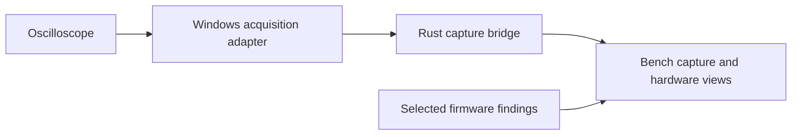

# Hardware / REA example

One real investigation, reduced to selected findings and aggregate measurements.
This is saved demo information, not live hardware, invented measurements or a
complete reproduction package. [summary.json](summary.json) holds the demo data.

[snapshot.json](snapshot.json) is a minimal bench-state envelope for this case,
provided as an editable adapter example. Its initial tick is local bookkeeping;
coordinates and capture time remain unavailable, and the instrument is stale.
It adds no invented readings or device connection details. Validate a copy with
`validate-snapshot FILE --json`; use `schema snapshot` for the accepted format.

## What it shows

- Identify the scope's installed software environment.
- Relate firmware observations to the hardware bench and capture workflow.
- Compare a recorded reference across repeated acquisitions.
- Keep measured, observed and unverified results separate.

The diagram shows software/data roles, not a physical wiring prescription or
included remote-access configuration. The Rust bridge is bench-owned transport
code; the instrument's firmware and acquisition protocol implementation are not
part of this example. This saved case describes that workflow; it does not start
the bridge or ship a hardware-control setup.

## Selected results

| Question | Retained result |
| --- | --- |
| Installed environment? | ARMv5 and Linux observed on a Hantek DSO2D15 |
| Temporary custom display? | Custom drawing and return to the normal display observed on one unit |
| Reference repeatability? | 10 saved captures; mean 999.997334 Hz; sample SD 0.015479 Hz |
| Clipping? | No clipped captures in that selection |
| Calibration or complete recovery? | Neither established; voltage conversion remains unqualified |

These measurements are aggregates of retained capture summaries. Source packets
are not included, so this bundle cannot independently reproduce their decoding
or establish absolute calibration. Display observations do not establish full
firmware reconstruction, persistent modification or a qualified rear graphics
transport.

## Distribution boundary

Included: this original written summary, a role diagram and selected aggregate
results. No setup or hardware connection is required to read the example.

Excluded: OEM firmware or code, decompiled functions, manuals/screenshots/models,
raw captures, extraction procedures, private analysis tools, serial numbers,
machine identities, addresses, credentials and SSH configuration. Users bring
their own data and tool providers.
