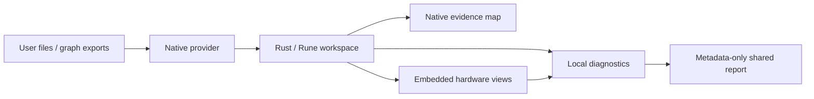

# Architecture

| Area | Implementation | Entry point |
| --- | --- | --- |
| Workspace and menus | Rust / Rune / Rune Kit | [workspace.rs](../experiments/rune/crates/cnc-ui-rune/src/workspace.rs) |
| Local files and imports | Rust; isolated app storage | [provider.rs](../experiments/rune/crates/cnc-ui-rune/src/provider.rs) |
| Dotdog export adapter | Saved JSON → native graph | [dotdog.rs](../experiments/rune/crates/cnc-ui-rune/src/dotdog.rs) |
| Evidence inspection | Native search and relationship navigation | [graph.rs](../experiments/rune/crates/cnc-ui-rune/src/graph.rs) |
| Hardware scenes | WebKit / Three / Carbon | [tabletop.js](../web/hardware/tabletop.js) |
| View composition | App-owned resource scheme | [embedded.rs](../experiments/rune/crates/cnc-ui-rune/src/embedded.rs) |
| Typed state and reports | Rust structs and enums | [bench-core](../crates/bench-core/src/lib.rs) |
| Developer inspector | Opt-in private Unix socket | [agent_debug.rs](../experiments/rune/crates/cnc-ui-rune/src/agent_debug.rs) |

No local TCP server or default remote endpoint is required. Native reads and
embedded resource requests share the local provider. Imports remain local and
do not launch analysis, firmware or devices. No private analysis engine is bundled.

The default case is one curated scope investigation summary. Hardware reference
relationships, RTL simulation and measured summaries have separate provenance.
Unknown readings remain null; imported files are not automatically live evidence.

The core and CLI need neither Node nor a browser. Building embedded views needs
Bun; preparing/querying Dotdog graphs needs the pinned Dotdog tooling. Current
desktop packaging targets macOS, not a verified cross-platform desktop release.

See [interaction conventions](interaction-design.md) for workspace and control guidance.

## Rust and embedded views

Keep OS access, artifact identity, import validation and evidence inspection in
native Rust. Use typed internal contracts; JSON remains the versioned file and
IPC boundary. Preserve unknown values and reject invalid inputs before storage.

Keep the existing Three.js scenes and plots embedded in WebKit. Moving a renderer
is not inherently a performance improvement. Replace a subsystem only after its
outputs, error behavior, keyboard access and rendered layout match; measure
representative workloads before claiming a speedup.

WASM is not required for the desktop app. Consider it only for a concrete need
to share pure computation with embedded views, not for filesystem or hardware
access. The [Rust WASM target](https://doc.rust-lang.org/rustc/platform-support/wasm32-unknown-unknown.html)
does not provide normal filesystem or thread support. The
[Rust API Guidelines](https://rust-lang.github.io/api-guidelines/) inform the
typed core; they do not justify rewriting working visual components.
